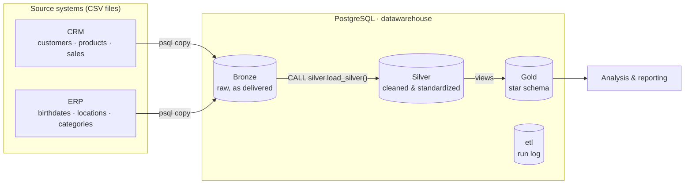
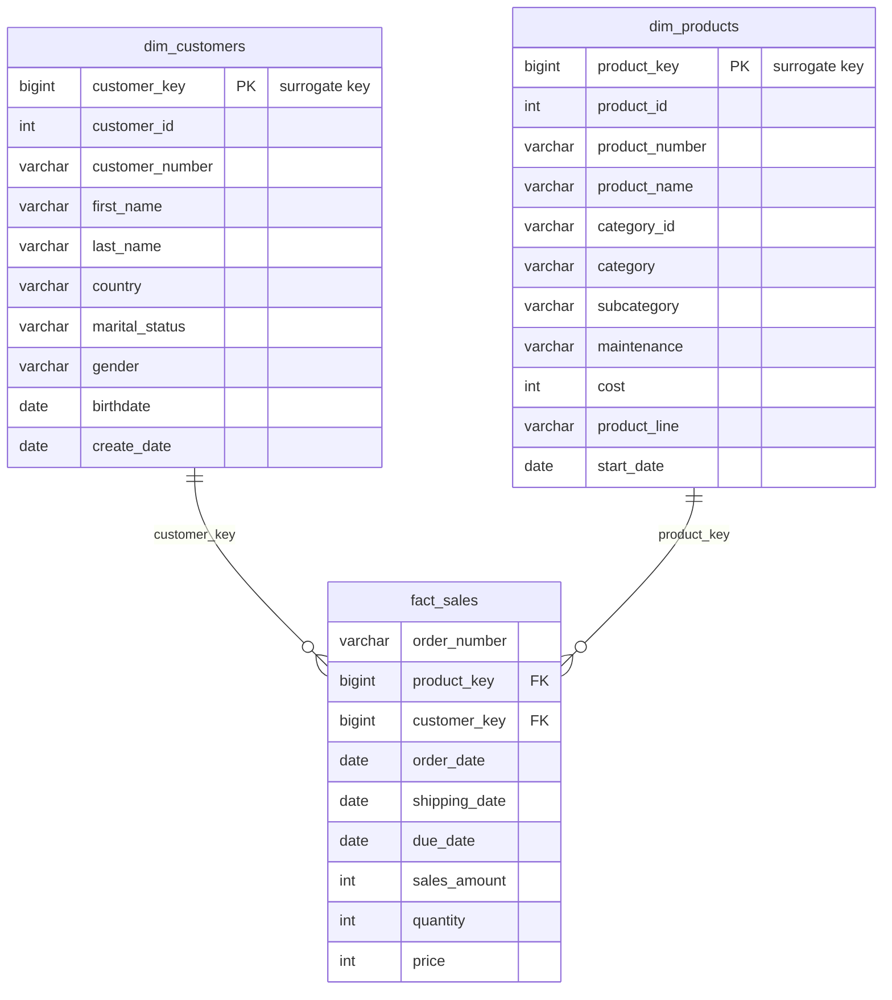

# SQL Data Warehouse in PostgreSQL


[](https://www.linkedin.com/in/ildar-mamin)

A data warehouse that combines sales data from two disconnected business systems (a CRM and an ERP), cleans it, and turns it into a star schema ready for analysis. It's built in PostgreSQL using the medallion architecture (bronze → silver → gold), runs end-to-end with one command, logs every run and tests its own output.

The whole pipeline, from raw CSV files to a tested star schema, runs in about 4 seconds:

```
Run #1

  [ OK ]  bronze_load       0.22s     116,294 rows in bronze
  [ OK ]  silver_load       0.40s     116,284 rows in silver
  [ OK ]  silver_checks     0.17s
  [ OK ]  gold_refresh      0.11s      79,177 rows in gold
  [ OK ]  gold_checks       0.67s

 Run #1 succeeded in 4.5s
```

---

## The business problem

A company that sells bikes, accessories and clothing keeps its data in two systems that don't talk to each other:

- **CRM** (sales system): customers, products, and 60,398 order lines
- **ERP** (back-office system): customer birthdates and gender, customer countries, and product categories

A question like *"Which countries buy the most mountain bikes, and how old are those buyers?"* needs data from both systems. The two systems also use different ID formats (`AW00011000` in the CRM, `NASAW00011000` and `AW-00011000` in the ERP), and both contain duplicates, typos, invalid dates and wrong totals.

This warehouse brings both sources into one clean, consistent model, so that question becomes a short query.

---

## Architecture



| Layer | Purpose | Object type | Load method |
|---|---|---|---|
| **Bronze** | Exact copy of the source files, errors included, so there is always an untouched copy of what was delivered | Tables | Full load: truncate + `\copy` from CSV, in one transaction |
| **Silver** | Cleaned, deduplicated, standardized data with proper data types | Tables | Full load: truncate + insert, via a stored procedure |
| **Gold** | Business-ready star schema with plain-English column names | Views | Always reflects the latest silver data |
| **etl** | Log of every pipeline run and step | Tables | Written by the pipeline script |

---

## Data quality: what was wrong, and how it was fixed

Before writing any cleaning logic, I profiled the raw data ([`analysis/01_profile_bronze.sql`](analysis/01_profile_bronze.sql)) to measure the actual problems. Every fix in silver is based on one of these findings:

| Source table | Problem found | Fix in silver |
|---|---|---|
| CRM customers | 4 rows without a customer ID | Removed |
| | 5 customers stored 2–3 times | Kept only the newest record (`ROW_NUMBER()`), which was also the most complete |
| | 29 names with leading/trailing spaces | Trimmed |
| | Codes like `M`, `S`, `F` | Spelled out: `Married`, `Single`, `Female` |
| CRM products | **200 of 397** price-history rows end *before* they start | End dates rebuilt: each version ends the day before the next one starts (`LEAD()`) |
| | Product key combines a category ID and a product key | Split into two columns so products can be joined to ERP categories |
| | 2 products without a cost | Set to 0 |
| CRM sales | Dates stored as integers (`20101229`); 19 invalid (`0`, `5489`, `32154`) | Converted to real dates; invalid ones become NULL |
| | 20 rows where sales ≠ quantity × price; negative or missing prices | Business rule applied: sales = quantity × price |
| ERP customers | 11,042 IDs with an extra `NAS` prefix | Prefix removed, so they match CRM keys |
| | 16 birthdates in the future | Set to NULL |
| | Gender written 8 different ways (`F`, `F `, `Female`, blanks…) | Standardized to `Female` / `Male` / `n/a` |
| ERP locations | Every ID contains a dash (`AW-00011000`) | Dash removed |
| | `DE` vs `Germany`, `US` / `USA` vs `United States`; 337 blanks | Standardized; blanks become `n/a` |

**Two findings worth knowing about:**

- **Integrating conflicting sources.** Both systems store gender. The CRM is missing it for 4,569 customers, and the ERP fills in 4,554 of those. In 57 cases the systems contradict each other. Rule: **the CRM is the master source**, and the ERP is only used to fill gaps.
- **A gap in the source data.** 7 pedal products have category ID `CO_PE`, which doesn't exist in the ERP's category list. They appear in gold with category `n/a`, and the gap is documented as a known exception in the quality checks.

---

## Data model (gold layer)



Every column is described in the [data catalog](docs/data_catalog.md).

---

## What the warehouse answers

From [`analysis/02_business_questions.sql`](analysis/02_business_questions.sql). The data covers orders from Dec 2010 to Jan 2014: 27,659 orders, 18,484 customers, about 29.4 million in revenue.

**Which countries buy the most mountain bikes, and how old are those buyers?**
Country and birthdate come from the ERP, sales from the CRM: the question needs both systems.

| Country | Revenue | Customers | Avg. age at purchase |
|---|---:|---:|---:|
| United States | 3,417,285 | 1,748 | 44 |
| Australia | 2,853,665 | 741 | 40 |
| United Kingdom | 1,162,919 | 470 | 43 |
| Germany | 1,003,751 | 419 | 43 |
| France | 899,219 | 419 | 43 |
| Canada | 615,415 | 292 | 45 |

**What drives revenue?**
Bikes are **96.5%** of revenue. Until the end of 2012 the company sold *only* bikes. Accessories and clothing launched on 28 Dec 2012, and in 2013 the number of buying customers grew from 3,255 to 17,427. Of those 17,427 customers, 95% bought accessories or clothing, and half (8,845) bought nothing else.

**Who spends the most per customer?**
Average spend per customer falls steadily with age, from 1,879 for customers under 30 to 1,008 for customers over 60.

---

## Dashboard

An interactive [Streamlit](https://streamlit.io) dashboard reads directly from the gold layer and the run log:

| Page | What it shows |
|---|---|
| **Sales overview** | Revenue (with growth 2013 vs 2012), orders, customers, average order value, units; monthly revenue and buying customers, with the product-line launch marked; revenue by category |
| **Customers** | Average and median spend, repeat-customer rate; revenue by country, spend by age group, customers by gender and marital status |
| **Products** | Top subcategories, revenue by product line, estimated gross margin by category, top 20 products |
| **Pipeline health** | Status and duration of the last run, success rate, row counts per layer compared with the previous run, step and run durations, full run history including failures |

Filters for year, country and category apply to the three business pages. The star-schema join and the age calculations run in PostgreSQL ([`dashboard/data.py`](dashboard/data.py)); the dashboard only filters and groups the result.

**Run it** (after the pipeline has been run at least once):

```powershell
python -m venv .venv
.venv\Scripts\pip install -r requirements.txt
.venv\Scripts\streamlit run dashboard/app.py
```

It opens at http://localhost:8501 and connects with the same settings as psql (`PGHOST`, `PGPORT`, `PGUSER`, and the password from pgpass or `PGPASSWORD`).

---

## Built beyond the original course

This project started from [Data With Baraa's SQL Server data warehouse course](https://github.com/DataWithBaraa/sql-data-warehouse-project). I rebuilt it in PostgreSQL and added the engineering a production pipeline needs:

| | Original (SQL Server) | This project (PostgreSQL) |
|---|---|---|
| **Run the pipeline** | Run each script and procedure by hand | One command: `run_pipeline.ps1` |
| **Failures** | The error is printed, but the job still looks successful | The step is marked failed, later steps are skipped, the script exits with code 1 |
| **Partial loads** | A failure mid-load leaves some tables reloaded and others not | Each layer loads in a single transaction: all or nothing |
| **Run history** | None | Every run and step logged in `etl.pipeline_runs` / `etl.step_log`: duration, row counts, errors |
| **Quality checks** | Queries you run and inspect by hand | 28 automated PASS/FAIL checks that stop the pipeline on failure |
| **Join safety** | Not checked | Gold checks prove the joins created no duplicates and lost no rows: totals match silver exactly |
| **File paths** | Hard-coded (`C:\sql\dwh_project\...`) | Relative to the project, so it runs on any machine |
| **Data profiling** | Not included | Profiling script that measures each problem before it is fixed |

Rebuilding the project also turned up one detail the original misses: SQL Server's `BULK INSERT` silently dropped the last row of `cust_info.csv`, because the file has no final line break. PostgreSQL loads all 18,494 rows. Bronze is meant to keep everything, and silver then removes that row on purpose (it's a junk row without an ID).

**Design decisions:**

- **Why bronze is loaded by a script, not a stored procedure.** Server-side `COPY` (like SQL Server's `BULK INSERT`) needs the database service to have read access to the CSV folder, which on Windows it usually doesn't. psql's client-side `\copy` reads the files as the user running it, so it works anywhere without permission changes.
- **Why the run log is written by the pipeline script.** When a stored procedure fails, PostgreSQL rolls back everything it did, including any log entry it wrote. Writing the log from outside, in separate transactions, means failures are always recorded.
- **Why gold uses views.** At this size (60k sales rows), views are fast and always show current data, with no extra load step. At a larger scale, or to keep history of changes, gold would become physical tables.

---

## How to run it

**Requirements:** PostgreSQL 13 or newer (tested on 18) and PowerShell (Windows PowerShell 5.1 or PowerShell 7 on any OS).

**1. Get the code:**

```powershell
git clone https://github.com/DarikCode/sql-data-warehouse-project.git
cd sql-data-warehouse-project
```

**2. Give psql your PostgreSQL password**, either through a [password file](https://www.postgresql.org/docs/current/libpq-pgpass.html) (`%APPDATA%\postgresql\pgpass.conf` on Windows, `~/.pgpass` elsewhere) with a line like this:

```
localhost:5432:*:postgres:your_password
```

or, for the current session only:

```powershell
$env:PGPASSWORD = "your_password"
```

**3. Build everything from scratch** (creates the `datawarehouse` database, loads all layers and runs all checks):

```powershell
.\run_pipeline.ps1 -Rebuild
```

**4. Reload later** (keeps the database and run history):

```powershell
.\run_pipeline.ps1
```

Options: `-ShowOutput` prints the full psql output, including every quality check. Connection settings default to `postgres@localhost:5432` and can be changed with `-DbHost`, `-Port` and `-User`, or with the standard `PGHOST` / `PGPORT` / `PGUSER` environment variables.

**See the run history:**

```sql
SELECT r.run_id, r.status, s.step_name, s.status AS step_status,
       s.duration_ms, s.rows_in_layer, s.message
FROM etl.pipeline_runs r
JOIN etl.step_log s USING (run_id)
ORDER BY r.run_id DESC, s.step_order;
```

---

## Project structure

```
sql-data-warehouse-project/
├── run_pipeline.ps1                 one-command pipeline: load, test, log
├── datasets/
│   ├── source_crm/                  cust_info, prd_info, sales_details
│   └── source_erp/                  CUST_AZ12, LOC_A101, PX_CAT_G1V2
├── scripts/
│   ├── 00_init_database.sql         creates the database and schemas
│   ├── bronze/
│   │   ├── ddl_bronze.sql           bronze tables
│   │   └── load_bronze.sql          CSV → bronze (\copy, one transaction)
│   ├── silver/
│   │   ├── ddl_silver.sql           silver tables
│   │   └── proc_load_silver.sql     bronze → silver cleaning procedure
│   ├── gold/
│   │   └── ddl_gold.sql             star schema views
│   └── etl/
│       └── ddl_etl.sql              run log tables
├── tests/
│   ├── quality_checks_silver.sql    19 checks
│   └── quality_checks_gold.sql      9 checks
├── analysis/
│   ├── 01_profile_bronze.sql        measures the problems in the raw data
│   └── 02_business_questions.sql    questions answered from gold
├── dashboard/
│   ├── app.py                       Streamlit entry point and filters
│   ├── data.py                      SQL queries against gold and the run log
│   ├── charts.py                    shared chart styling
│   └── views/                       overview, customers, products, pipeline health
├── requirements.txt                 dashboard Python packages
└── docs/
    └── data_catalog.md              every gold column explained
```

---

## SQL Server → PostgreSQL: what changed

| SQL Server (original) | PostgreSQL (this project) |
|---|---|
| `BULK INSERT` inside a procedure | psql `\copy` in a transaction |
| `USE DataWarehouse` | `\connect datawarehouse` |
| `PRINT` | `RAISE NOTICE` |
| `BEGIN TRY … BEGIN CATCH` | `BEGIN … EXCEPTION WHEN OTHERS`, then re-raise |
| `GETDATE()` for timing | `clock_timestamp()` (`now()` stays fixed for the whole transaction) |
| `ISNULL()`, `LEN()` | `COALESCE()`, `length()` |
| `CAST(CAST(20101229 AS VARCHAR) AS DATE)` | `to_date(20101229::text, 'YYYYMMDD')` |
| `datetime - 1` (subtract a day) | `date - 1` (cast to `date` first) |
| `NVARCHAR`, `DATETIME2` | `VARCHAR`, `TIMESTAMP` |
| `IF OBJECT_ID(...) IS NOT NULL DROP` | `DROP ... IF EXISTS` |

---

## Credits

Based on the [SQL Data Warehouse project](https://github.com/DataWithBaraa/sql-data-warehouse-project) by **Baraa Khatib Salkini** ([Data With Baraa](https://www.datawithbaraa.com)), which supplied the datasets, the original SQL Server design and the cleaning rules. Released under the MIT License; see [LICENSE](LICENSE).

## About me

**Ildar Mamin** is an M.Sc. (Tech) student in Industrial Engineering and Management at LUT University, Finland, specializing in data analytics for decision-making.
